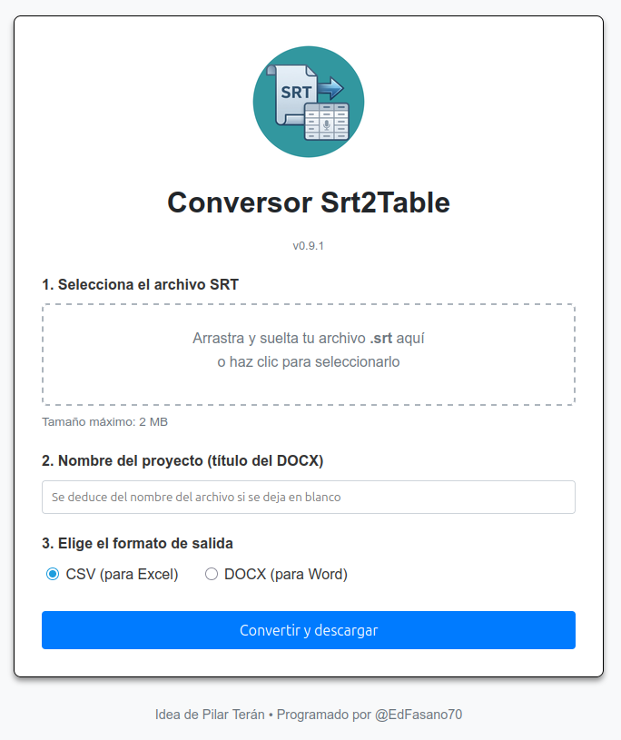

# Srt2Table

<p align="center">
  
</p>

Convierte archivos de subtítulos **`.srt`** a **CSV** (Excel) o **DOCX** (Word).
Aplicación web en **PHP** con frontend **vanilla JS**, sin base de datos y sin
build step. Interfaz en español.

[](https://www.php.net/)
[](https://developer.mozilla.org/es/docs/Web/JavaScript)
[](https://getcomposer.org/)

## Características

- **Arrastrar y soltar** el archivo `.srt` o seleccionarlo con el explorador.
- Salida a **CSV** (para Excel) o **DOCX** (para Word).
- **CSV con BOM UTF-8**: Excel respeta acentos y la flecha `→`.
- **Parser SRT tolerante**: BOM, saltos CRLF/CR, bloques sin línea en blanco,
  milisegundos con `.` o `,`, milisegundos opcionales y etiquetas sin cerrar.
- **Validación en el servidor** de tipo, formato y tamaño, con mensajes claros.
- Conversión **stateless**: no guarda archivos ni usa base de datos.
- **PWA instalable** (manifest e iconos). Interfaz mobile-friendly.

## Stack

| Capa | Tecnología |
|------|------------|
| Frontend | HTML5 + CSS propio + JavaScript vanilla (drag & drop) |
| Backend | PHP 8 (un único `index.php` + `lib/srt.php`) |
| DOCX | `phpoffice/phpword` vía Composer |
| CSV | Nativo de PHP (`fputcsv`) |
| Servidor | Apache + HTTPS |

## Estructura

```
index.php            Página y endpoint de conversión
lib/srt.php          Parser SRT + generación de CSV/DOCX (testeable)
VERSION              Versión de la app (fuente única, mostrada en la UI)
tests/run.php        Tests CLI de la conversión
tests/fixtures/      SRT de ejemplo para los tests
composer.json/lock   Dependencias
vendor/              Dependencias instaladas (no versionado)
screenshot.png       Captura de la aplicación
```

## Requisitos

- PHP 8.1+ con extensión `mbstring`.
- Composer (solo para instalar PHPWord).
- Apache + HTTPS en producción (opcional en local con `php -S`).

## Instalación

```bash
git clone https://github.com/edfasano70/srt2table.git
cd srt2table
composer install      # crea vendor/ con PHPWord
```

## Desarrollo local

```bash
php -S localhost:8000
# Abre http://localhost:8000/
```

## Tests

```bash
php tests/run.php     # salida PASS/FAIL; 0 = OK
```

## Despliegue

```bash
# 1. Subir el proyecto (vendor/ se excluye y se regenera en el servidor)
rsync -az --delete --exclude '.git' --exclude 'vendor' ./ usuario@SERVIDOR:/var/www/html/srt2table/

# 2. Instalar dependencias en el servidor
ssh usuario@SERVIDOR 'cd /var/www/html/srt2table && composer install --no-dev'
```

Apache: exponer por HTTPS y **bloquear código fuente y ficheros de proyecto**.
Bloque de ejemplo para un vhost existente:

```apache
Alias /srt2table /var/www/html/srt2table

<Directory /var/www/html/srt2table>
    Options -Indexes +FollowSymLinks
    Require all granted
    <FilesMatch "\.(py|ini|lock|spec|json|bak)$">
        Require all denied
    </FilesMatch>
    <Files "VERSION">
        Require all denied
    </Files>
</Directory>
<Directory /var/www/html/srt2table/lib>
    Require all denied
</Directory>
<Directory /var/www/html/srt2table/tests>
    Require all denied
</Directory>
```

## Seguridad

- Cabeceras `X-Content-Type-Options`, `Referrer-Policy`, `X-Frame-Options` y
  **CSP con nonce** para los scripts.
- Validación en servidor del archivo y del formato de salida.
- Sin base de datos ni persistencia de archivos subidos.

## Créditos

- **Idea:** Pilar Terán
- **Programación:** [@EdFasano70](https://github.com/edfasano70)
